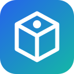

<div align="center">
  

  # Product Details API

  A production-ready Flask REST API for fast, reliable product catalog data.

  <p>
    <a href="https://www.python.org/"></a>
    <a href="https://flask.palletsprojects.com/"></a>
    <a href="https://render.com/"></a>
  </p>
</div>

## About

Product Details API is a focused Flask service that exposes product data through a clean, predictable HTTP interface. It is designed to be easy to run locally, containerize, and deploy as a small production-ready web service.

The service currently provides:

- A health-check endpoint
- A collection endpoint for all products
- A detail endpoint for an individual product
- JSON responses with clear HTTP status codes
- Environment-based port configuration for flexible deployment

## API reference

| Method | Endpoint | Description | Success |
| --- | --- | --- | --- |
| `GET` | `/` | Check whether the service is running | `200 OK` |
| `GET` | `/products` | Retrieve the complete product collection | `200 OK` |
| `GET` | `/products/<product_id>` | Retrieve one product by ID | `200 OK` |

Requests for an unknown product return `404 Not Found`.

### Example response

`GET /products/1`

```json
{
  "id": "1",
  "name": "Laptop",
  "price": 999.99,
  "category": "Electronics"
}
```

## Run locally

### Prerequisites

- Python 3.11 or newer
- `pip`

### Setup

```bash
git clone https://github.com/PVegananda/product-details-api.git
cd product-details-api

python -m venv .venv
source .venv/bin/activate
pip install -r requirements.txt
python app.py
```

The API is available at `http://localhost:10000`.

On Windows PowerShell, activate the virtual environment with:

```powershell
.venv\Scripts\Activate.ps1
```

To use a different port:

```bash
PORT=8080 python app.py
```

## Run with Docker

```bash
docker build -t product-details-api .
docker run --rm -p 10000:10000 -e PORT=10000 product-details-api
```

## Deployment

The repository includes a `render.yaml` blueprint for deployment on Render. Connect the repository to Render and deploy the configured web service. Render will install the dependencies from `requirements.txt` and start the application with the configured command.

## Project structure

```text
.
├── app.py             # Flask application and API routes
├── requirements.txt   # Python dependencies
├── Dockerfile         # Container image definition
├── Procfile           # Process command for compatible platforms
├── render.yaml        # Render deployment configuration
└── assets/
    └── product-details-api.svg
```

## Technology

- [Python](https://www.python.org/)
- [Flask](https://flask.palletsprojects.com/)
- [Docker](https://www.docker.com/)
- [Render](https://render.com/)

## License

This project is available for personal and portfolio use. Add a license file if you plan to distribute or reuse it under specific terms.

---

Built with Python and Flask by [PVegananda](https://github.com/PVegananda).
